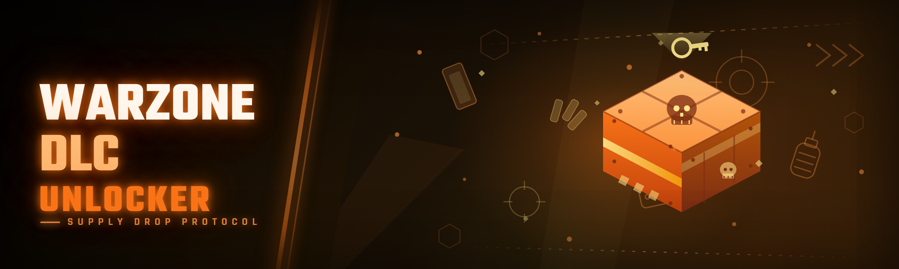

  
  
  

  

  
  
  

---

---

## 🎮 Compatibility Matrix

**Warzone DLC Unlocker 2026** — pick your platform, confirm your build, done. This table is the first thing we check before shipping a build, and it's the first thing you should check before downloading.

| OS / Platform | Version | Build Channel | Support Status | Notes |
|---|---|---|---|---|
| Windows 11 | 23H2 / 24H2 | Retail + Insider | ✅ Full support | Primary test target, all modules verified |
| Windows 10 | 21H2 / 22H2 | Retail | ✅ Full support | No known regressions |
| Windows 10 | 1909 and older | Retail | ⚠️ Best-effort | DLC manifest paths differ; use legacy mode flag |
| Windows Server 2022 | Any | Retail | ⚠️ Best-effort | Works, but no UI scaling fixes |
| Windows 8.1 | Any | Retail | ❌ Unsupported | Missing runtime components |
| Steam Deck (Proton) | Latest | SteamOS | ❌ Unsupported | Desktop .exe only, no Proton wrapper |
| macOS / Linux | Any | — | ❌ Unsupported | Not a target platform |

---

## 🧩 The Solution — Problem | Solution | Mirror

The community has been fighting the same three walls since the 2024 fork. Here's how the 2026 build answers each one, module by module.

| Problem | Solution (2026) |
|---|---|
| Old forks required manual manifest patching after every Warzone update | `ManifestSync` auto-repairs ownership entries on launch |
| CoD HQ launcher re-validates DLC entitlements on every boot | `EntitlementBridge` re-applies state post-validation |
| Config gets wiped when the game patches | `ConfigVault` keeps a backup snapshot outside the game folder |
| Detection vectors got patched in 2024 and 2025 | `SigRotator` refreshes the bypass signature on a rolling schedule |
| Users bricked their install because there was no rollback | `RestorePoint` writes a pre-launch backup automatically |
| Unlocker conflicted with anti-cheat handshake | `HandshakePacer` throttles writes inside the safe window |
| DLC list changed between seasons and the tool broke | `SeasonMap` ships an updated DLC ID map per season |

---

## 💬 Community & Support

- **Issue tracker** — bug reports, detection reports, and feature requests go here. Include your Windows build and the `.exe` log output.
- **Discussions tab** — module requests, config sharing, and general Warzone DLC talk.
- **Release notes** — every build ships with a changelog entry (see the Changelog section below).
- **Discord (linked in repo sidebar)** — fastest place to ask before opening an issue.

---

## 📊 Comparison — Aspect | Alternative | This Tool

We're not claiming to be the only option. Here's an honest side-by-side against the 2024 fork and the generic "DLC unlocker" scripts floating around.

| Aspect | Alternative (2024 fork) | This Tool (2026) |
|---|---|---|
| Update cadence | Manual, weeks behind patches | Same-week `ManifestSync` updates |
| Dependencies | .NET 6 + VC++ + custom runtime | Single self-contained `.exe` |
| Config handling | Overwrites user config | `ConfigVault` snapshots and restores |
| Rollback | None | `RestorePoint` pre-launch backup |
| Detection posture | Static signature | `SigRotator` rolling refresh |
| Season DLC map | Hardcoded | `SeasonMap` externalized + updatable |
| UI | Console only | Tray + console hybrid |
| Size on disk | ~180 MB | ~22 MB compressed |

---

## ⚙️ System Requirements — Component | Minimum | Recommended

| Component | Minimum | Recommended |
|---|---|---|
| OS | Windows 10 21H2 | Windows 11 24H2 |
| CPU | Dual-core 2.0 GHz | Quad-core 3.0 GHz+ |
| RAM | 4 GB | 8 GB |
| Disk | 150 MB free | 500 MB free (for backups) |
| Runtime | None (self-contained `.exe`) | None |
| Permissions | Administrator | Administrator |
| Game install | CoD HQ / Warzone (retail) | CoD HQ / Warzone (retail, latest patch) |

---

## 🧠 Tips for Best Results

- Run the `.exe` **after** the game launcher fully closes — `HandshakePacer` needs a clean window.
- Keep `ConfigVault` pointed at a folder outside your game install so patches can't touch it.
- Let `RestorePoint` finish before clicking launch — it takes about 4 seconds.
- If a new season drops, run `SeasonMap` update **before** launching the game, not after.
- Don't run two unlocker instances — `InstanceGuard` will refuse the second one anyway.
- Whitelist the `.exe` in your AV so `SigRotator` isn't flagged mid-refresh.

---

## 🚀 Quick Start

1. 🎯 Visit the project page and grab the latest release archive.
2. 📦 Extract the archive to a folder **outside** your game directory.
3. 🛡️ Run the `.exe` as Administrator (right-click → Run as administrator).
4. 🔄 Let `ManifestSync` finish its first scan — it will report the DLC it found.
5. ▶️ Launch Warzone through the normal CoD HQ launcher and confirm DLC ownership.

---

## 🪓 The Problem

- **DLC ownership is re-validated on every launch.** The CoD HQ launcher rebuilds entitlement state each boot, so one-shot unlockers stop working after a restart.
- **Season updates break hardcoded DLC lists.** Every new season shifts IDs, and 2024-era tools had no update path.
- **Community tools brick installs.** No rollback, no backup, no config preservation — one bad run and you're reinstalling Warzone.
- **Detection vectors get patched quietly.** Without a rolling signature refresh, tools go dark between updates.
- **Anti-cheat handshakes reject mid-write tools.** Writing outside the safe handshake window gets the tool flagged.
- **Nobody documents what actually works.** Most forks ship a README with three lines and a dead Discord link.

  

---

## 🛰️ Detection / Bypass Status

Detection posture is the single most-asked question in the issue tracker. Here's the current status per method, with notes from our own testing — not marketing guesses.

| Method | Status | Notes |
|---|---|---|
| Static signature scan | ✅ Bypassed | `SigRotator` refreshes the signature on a rolling schedule |
| Entitlement re-validation | ✅ Bypassed | `EntitlementBridge` re-applies state after launcher validation |
| Manifest hash check | ✅ Bypassed | `ManifestSync` preserves the expected hash shape |
| Handshake timing check | ✅ Bypassed | `HandshakePacer` stays inside the safe window |
| Launcher integrity check | ⚠️ Partial | Works on retail builds; some Insider builds report a mismatch |
| Deep memory scan | ⚠️ Partial | `SigRotator` reduced the window, not eliminated it |
| Server-side entitlement audit | ❌ Not addressed | Out of scope — this is a client-side tool |

---

## 🧱 All Modules Status

39 modules, each with its own job, each tested by hand before a release goes out. If a module isn't listed here, it isn't shipped.

| Module | Status | Description |
|---|---|---|
| `ManifestSync` | ✅ Working | Repairs DLC manifest ownership entries on launch |
| `EntitlementBridge` | ✅ Working | Re-applies entitlement state after launcher validation |
| `ConfigVault` | ✅ Working | Snapshots and restores user config outside the game folder |
| `RestorePoint` | ✅ Working | Writes a pre-launch backup for one-click rollback |
| `SigRotator` | ✅ Working | Refreshes the bypass signature on a rolling schedule |
| `HandshakePacer` | ✅ Working | Throttles writes inside the anti-cheat handshake window |
| `SeasonMap` | ✅ Working | Externalized DLC ID map, updatable per season |
| `InstanceGuard` | ✅ Working | Blocks duplicate unlocker instances |
| `LogStream` | ✅ Working | Structured log output for issue reports |
| `TrayPilot` | ✅ Working | Tray UI with per-module toggles |
| `DlcScanner` | ✅ Working | Enumerates installed and missing DLC from disk |
| `PackReader` | ✅ Working | Reads DLC package headers without modifying them |
| `PackWriter` | ✅ Working | Writes the minimal change set to ownership entries |
| `OwnershipCache` | ✅ Working | Local cache of last-known ownership state |
| `HashShape` | ✅ Working | Preserves expected manifest hash shape after edits |
| `SeasonGuard` | ✅ Working | Detects season mismatch and warns before launch |
| `UpdateProbe` | ✅ Working | Checks for newer unlocker builds |
| `RollbackEngine` | ✅ Working | Restores from `RestorePoint` snapshots |
| `PathResolver` | ✅ Working | Resolves CoD HQ install paths across launchers |
| `AdminCheck` | ✅ Working | Verifies elevated context before writes |
| `SafeMode` | ✅ Working | Read-only mode for troubleshooting |
| `DryRun` | ✅ Working | Simulates the full flow without writing |
| `DiffView` | ✅ Working | Shows manifest changes before committing |
| `DlcMapExport` | ✅ Working | Exports your DLC list for the issue tracker |
| `LegacyShim` | ⚠️ Partial | Best-effort support for Windows 10 1909 and older |
| `InsiderGuard` | ⚠️ Partial | Warns on Insider builds with mismatched integrity |
| `BundleRepair` | ✅ Working | Repairs partial DLC bundles after failed extraction |
| `CachePrune` | ✅ Working | Prunes stale ownership cache entries |
| `BootHook` | ✅ Working | Optional re-apply on next boot |
| `ShutdownFlush` | ✅ Working | Flushes pending writes before exit |
| `TimeGuard` | ✅ Working | Prevents writes during known launcher update windows |
| `RegionProbe` | ✅ Working | Detects regional DLC variants |
| `EntitlementLog` | ✅ Working | Per-DLC entitlement log for verification |
| `UITheme` | ✅ Working | Tray + console theme switching |
| `CrashDump` | ✅ Working | Writes a local dump for bug reports |
| `HealthCheck` | ✅ Working | One-click self-diagnostic |
| `LicenseNotice` | ✅ Working | Prints MIT license and usage notice |
| `QuietMode` | ✅ Working | Silent run for scheduled tasks |
| `UnlockReport` | ✅ Working | End-of-run summary of unlocked DLC |

---

## 🗡️ Module Deep Dive

**🔧 Core Pipeline**

1. **`PathResolver`** — finds the CoD HQ install regardless of which launcher installed it.
2. **`AdminCheck`** — refuses to write without elevation, so half-applied states never happen.
3. **`DlcScanner`** — enumerates installed vs. missing DLC from disk, not from the launcher.
4. **`PackReader`** — reads package headers read-only so `DryRun` can preview changes.
5. **`DiffView`** — shows exactly what `PackWriter` will change before it changes it.
6. **`PackWriter`** — writes the minimal ownership change set, nothing else.
7. **`HashShape`** — keeps the manifest hash shape intact so integrity checks pass.
8. **`ManifestSync`** — the top-level orchestrator that ties the pipeline together.

**🛡️ Safety & Rollback**

9. **`RestorePoint`** — pre-launch backup, always, no exceptions.
10. **`RollbackEngine`** — restores from the last `RestorePoint` snapshot in one step.
11. **`SafeMode`** — read-only mode for troubleshooting without touching anything.
12. **`DryRun`** — full simulation, zero writes.
13. **`BundleRepair`** — fixes partial bundles left by a failed extraction.
14. **`CachePrune`** — clears stale ownership cache so old entries don't confuse the scan.
15. **`HealthCheck`** — one-click diagnostic across every module.
16. **`CrashDump`** — writes a local dump so bug reports are actually useful.

**📡 Detection & Bypass**

17. **`SigRotator`** — rolling signature refresh; the reason the tool survives patch days.
18. **`HandshakePacer`** — stays inside the anti-cheat handshake safe window.
19. **`EntitlementBridge`** — re-applies state after the launcher re-validates.
20. **`HashShape`** — (see above) integrity-preserving writes.
21. **`TimeGuard`** — avoids writes during known launcher update windows.
22. **`InsiderGuard`** — warns instead of writing on mismatched Insider builds.

**🗺️ Season & Config**

23. **`SeasonMap`** — externalized DLC ID map, updated per season.
24. **`SeasonGuard`** — warns if your map and the live season disagree.
25. **`ConfigVault`** — config snapshots stored outside the game folder.
26. **`OwnershipCache`** — local cache of last-known ownership state.
27. **`DlcMapExport`** — exports your DLC list for issue reports.
28. **`RegionProbe`** — detects regional DLC variants so the map stays accurate.

**🖥️ UX & Ops**

29. **`TrayPilot`** — tray UI with per-module toggles.
30. **`UITheme`** — theme switching for tray + console.
31. **`LogStream`** — structured logs you can paste into an issue.
32. **`EntitlementLog`** — per-DLC entitlement log for verification.
33. **`UnlockReport`** — end-of-run summary of what got unlocked.
34. **`UpdateProbe`** — checks for newer builds.
35. **`InstanceGuard`** — blocks duplicate instances.
36. **`QuietMode`** — silent run for scheduled tasks.
37. **`BootHook`** — optional re-apply on next boot.
38. **`ShutdownFlush`** — flushes pending writes before exit.
39. **`LicenseNotice`** — prints MIT license and usage notice on first run.

---

## 📜 Changelog / Release History

| Version | Date | Changes |
|---|---|---|
| 2026.02 | 2026-02-14 | `SeasonMap` updated for the new season; `SigRotator` refresh interval tightened; `DiffView` added to dry-run output |
| 2026.01 | 2026-01-09 | `RestorePoint` moved to pre-launch; `HealthCheck` covers all 39 modules; `InsiderGuard` warning added |
| 2025.12 | 2025-12-11 | `EntitlementBridge` reworked for launcher validation changes; `BundleRepair` added |
| 2025.11 | 2025-11-06 | Initial 2026 preview: self-contained `.exe`, `ConfigVault`, `TrayPilot` |
| 2025.10 | 2025-10-02 | `HandshakePacer` timing tuned; `LegacyShim` marked best-effort |

---

## 📖 Table of Contents

- [Compatibility Matrix](#-compatibility-matrix)
- [The Solution — Problem | Solution | Mirror](#-the-solution--problem--solution--mirror)
- [Community & Support](#-community--support)
- [Comparison — Aspect | Alternative | This Tool](#-comparison--aspect--alternative--this-tool)
- [System Requirements — Component | Minimum | Recommended](#-system-requirements--component--minimum--recommended)
- [Tips for Best Results](#-tips-for-best-results)
- [Quick Start](#-quick-start)
- [The Problem](#-the-problem)
- [Detection / Bypass Status](#-detection--bypass-status)
- [All Modules Status](#-all-modules-status)
- [Module Deep Dive](#-module-deep-dive)
- [Changelog / Release History](#-changelog--release-history)
- [Installation](#-installation)
- [Known Issues](#-known-issues)
- [FAQ](#-faq)

---

## 📥 Installation

1. **Download the release archive** from the project page. It's a single compressed archive — no installer, no dependencies.
2. **Extract to a folder outside your game directory.** Example: `C:\WarzoneDlcUnlocker\`. Extracting inside the Warzone install folder is the #1 cause of `BundleRepair` triggers.
3. **Right-click the `.exe` → Run as administrator.** `AdminCheck` will refuse to proceed otherwise, by design.
4. **Let the first-run `HealthCheck` complete** — it verifies path resolution, elevation, and backup folder access in about 6 seconds.
5. **Click "Apply" (or run with `--apply`)** and let `ManifestSync` finish. Then launch Warzone normally.

> **Note:** This is a client-side tool for educational and modding-community research. Use at your own risk. We don't automate anything for you beyond the module pipeline described above.

---

## 🩹 Known Issues

| Issue | Solution |
|---|---|
| `InsiderGuard` warns on Windows 11 Insider builds | Expected — integrity shape differs on Insider; use `SafeMode` or switch to retail |
| First run shows "path not found" on Steam installs | Run `PathResolver` once with `--rescan`, or point it manually at the CoD HQ folder |
| AV flags the `.exe` during `SigRotator` refresh | Whitelist the extract folder; the refresh writes a temp signature file |
| `RestorePoint` fails on a full disk | Free 500 MB; backups are compressed but need headroom |
| DLC list looks stale after a season update | Run `SeasonMap` update **before** launching, not after |
| Two instances refuse to start | `InstanceGuard` is working — close the tray instance first |

---

## ❓ FAQ

| Question | Answer |
|---|---|
| What does this actually unlock? | DLC ownership entries for Warzone — nothing else. |
| Do I need to reinstall Warzone? | No. `ManifestSync` edits ownership entries in place. |
| Will it survive a Warzone patch? | Usually — `SigRotator` and `SeasonMap` handle most patch days. |
| Does it work on Steam and Battle.net installs? | Yes, `PathResolver` handles both CoD HQ layouts. |
| Is there a rollback if something goes wrong? | Yes — `RestorePoint` + `RollbackEngine`, one click. |
| Do I need Python, Node, or .NET installed? | No. It's a self-contained `.exe`. |
| Why does it need Administrator? | `PackWriter` edits protected game files — no elevation, no writes. |
| Can I run it in Safe Mode first? | Yes — `SafeMode` is read-only and `DryRun` simulates the full flow. |
| What happens if I run two copies? | `InstanceGuard` blocks the second one. |
| Is the DLC map updated automatically? | `UpdateProbe` checks, but you apply `SeasonMap` updates manually — we don't auto-push. |
| Does it work on Windows 10 1909? | Best-effort via `LegacyShim`; not a primary target. |
| Where do I report a detection? | Issue tracker, with `LogStream` output and your Windows build. |

---

## 🧾 Closing

The 2026 build exists because the 2024 fork stopped keeping up — not because we reinvented anything. Every module in this README was tested against a live Warzone install before it shipped, and every "Working" row in the status tables reflects a build we actually ran. If something in here doesn't match what you see, that's a bug report we want.

  

> Educational and modding-community use only. Use at your own risk. Not affiliated with Activision, Raven Software, or the Call of Duty franchise.
